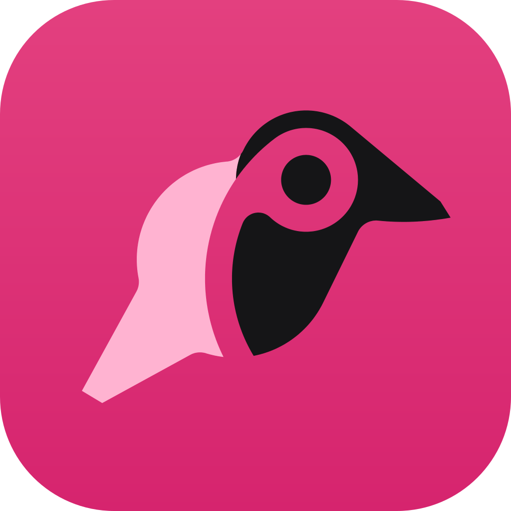
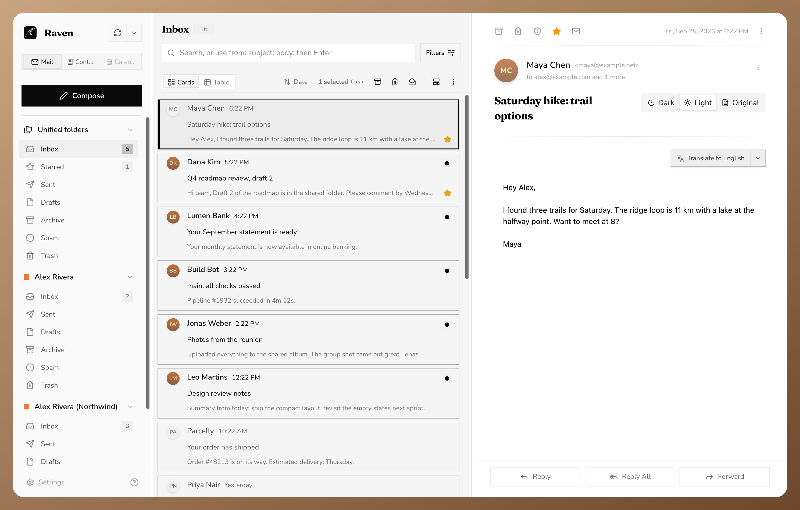
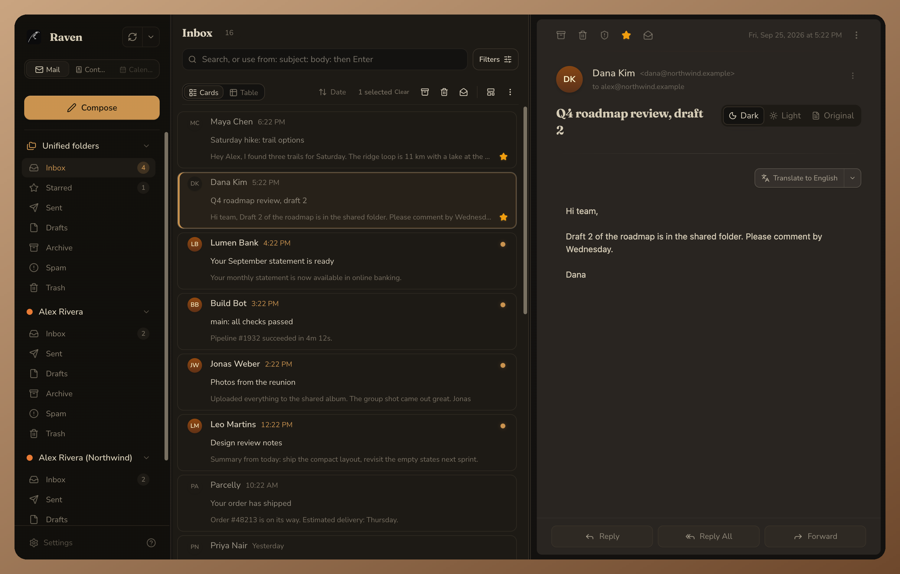

<h1>
  
  Raven
</h1>

| Minimal light | Classic dark |
| --- | --- |
|  |  |

[View all screenshots](./screenshots/README.md) · Screenshots use made-up demo data.

<br>

Raven is a local-first email client with a built-in calendar and contacts. It runs on your own machine, keeps mail and related data local, and talks directly to mail, calendar and contact providers. Generic accounts use IMAP/SMTP, CalDAV and CardDAV. Gmail uses the Gmail, Google Calendar and Google People APIs. Outlook uses Microsoft Graph.

It's built with Go, templ views, HTMX-style interactions, and SQLite storage.

## features

- **Mail:** multiple IMAP/SMTP, Gmail, and Outlook accounts, with real-time sync, threads, attachments, drafts with autosave, signatures, sending identities, scheduled send, one-click unsubscribe, and translation.
- **Organization and search:** folders, labels, stars, archive, spam controls, select-all across a whole folder, and advanced search filters.
- **Calendar:** Google, Outlook, and CalDAV (including iCloud) calendars in month, week, and agenda views, with event creation, invitations, and replies from the inbox.
- **Contacts:** local address books, vCard import/export, and Google, Outlook, and CardDAV sync.
- **Desktop app:** a Tauri app in [`tauri-wrapper/`](./tauri-wrapper) for macOS, Windows, and Linux, with an unread count on the Dock/taskbar icon, a global compose shortcut (`Cmd/Ctrl+Shift+M`), and automatic updates.
- **Phone:** a phone layout and Web Push notifications, for use as an installed web app when Raven runs on a server you can reach.
- **Security:** encrypted stored credentials, remote content blocked by default and loaded through Raven when allowed, and optional sign-in with passwords, TOTP, passkeys, or external providers.
- **Access modes:** no-login local use, one protected personal profile, or managed users with separate administrators.
- **Customization:** themes, layouts, account colors, and regional settings.

## status

Raven is alpha software. Expect things to change.

## installing the desktop app

Download the installer for your platform from the [latest release](https://github.com/fahadjibransheikh/raven/releases/latest):

- **macOS (Apple Silicon):** `Raven_<version>_aarch64.dmg`
- **Windows (x64):** `Raven_<version>_x64-setup.exe` or `Raven_<version>_x64_en-US.msi`
- **Linux (x86_64):** `.deb` (Debian/Ubuntu), `.rpm` (Fedora/RHEL), or the portable `.AppImage`

On macOS (Apple Silicon) and Linux (x86_64) you can use Homebrew instead:

```sh
brew tap fahadjibransheikh/raven https://github.com/fahadjibransheikh/raven
brew install --cask fahadjibransheikh/raven/raven
```

Use the full `fahadjibransheikh/raven/raven` name: a plain `brew install raven` installs an unrelated Homebrew formula.

On Linux, Homebrew installs the AppImage as `~/Applications/Raven.AppImage` and adds Raven to your app launcher.

The macOS app isn't signed or notarized yet. If you install the `.dmg` and macOS says it can't verify Raven, open System Settings → Privacy & Security and click **Open Anyway**. The Homebrew install doesn't need this.

Once installed, Raven updates itself. On Linux that works for the AppImage; with the `.deb` or `.rpm`, install the new package from the release page.

The desktop app keeps its settings (`.env`) and mail (`data/`) in the per-user app data folder: `~/Library/Application Support/com.fahadsheikh.raven` on macOS, `%APPDATA%\com.fahadsheikh.raven` on Windows, and `~/.local/share/com.fahadsheikh.raven` on Linux. To configure it, copy [`.env.example`](./.env.example) there as `.env`.

## running and building

Downloaded release binaries include the web assets. Development from source requires Go, `templ`, `tailwindcss`, and `task`.

```sh
task dev      # development server with hot reload
task build    # local build at ./tmp/main
task release  # self-contained binary at ./dist/raven-server
```

With the development server running, open `http://local.localhost:8090`. See the [Taskfile](./Taskfile.yml) for packaging and other build tasks, and [`tauri-wrapper/README.md`](./tauri-wrapper/README.md) for building the desktop app.

## releasing

1. Bump `version` in `tauri-wrapper/src-tauri/Cargo.toml` and commit.
2. Tag and push: `git tag vX.Y.Z && git push origin master vX.Y.Z`.

GitHub Actions builds all three platforms, publishes the release with signed update files, and commits the Homebrew cask bump to `master` (run `git pull` afterwards). Then replace the placeholder under **Changes** in the release notes. The [`release`](./.claude/skills/release/SKILL.md) Claude skill covers every step, including writing the notes. Details, including the update signing key, are in [`tauri-wrapper/README.md`](./tauri-wrapper/README.md#releasing).

## setup and configuration

Raven runs locally without a login by default. It also supports personal mode (one protected profile with multiple mailboxes) and managed mode (separate administrators and webmail users). See [`.env.example`](./.env.example) for configuration options. Authenticated modes guide you through first-run setup using a token printed in the terminal.

Generic IMAP/SMTP accounts need no OAuth application credentials. Gmail and Outlook currently require your own provider client ID and secret. Mailbox authorization and optional Google/Microsoft application sign-in use separate clients and callbacks.

Raven doesn't connect to mail servers, or to calendar and contacts servers it discovers on its own, on private network addresses unless they are approved. If a mail server is on your local network, approve it under Mail security (Settings, Security in the desktop app and in personal or open mode; the admin panel in managed mode). In open and personal mode, a CalDAV or CardDAV server on your local network works as soon as you type its address. Only that exact host and port is trusted; any other private address a server points to (a redirect, or a link in its responses) still needs approval. In managed mode every private address, typed or not, needs an administrator's approval. To sign in over plain HTTP on a private network, set `RAVEN_BASE_URL` to the server's private address and `RAVEN_ALLOW_INSECURE_LAN=true`; public addresses and host names still require HTTPS. The older `GOFER_` names (for example `GOFER_BASE_URL`) still work; Raven logs a notice at startup when it reads one.

When you run the server yourself, runtime data is stored in `data/` in its working directory by default (the desktop app uses its app data folder, above). Keep it and your secrets private. The default listener is loopback-only; remote access requires explicit configuration.

## admin panel

In managed mode, `/admin` provides user administration, invitations, security policies, and security activity. It also includes diagnostics for account sync, contacts, avatars, and provider behavior.

## built with

Raven is built on these libraries and tools:

- [templ](https://templ.guide/) for Go-based views
- [templUI](https://templui.io/) for several UI components
- [HTMX](https://htmx.org/) for server-driven interactions
- [Tailwind CSS](https://tailwindcss.com/) for styling
- [modernc.org/sqlite](https://pkg.go.dev/modernc.org/sqlite) for SQLite storage
- [emersion](https://github.com/emersion)'s Go mail libraries, including [go-imap](https://github.com/emersion/go-imap), [go-smtp](https://github.com/emersion/go-smtp), [go-message](https://github.com/emersion/go-message), [go-sasl](https://github.com/emersion/go-sasl), and [go-vcard](https://github.com/emersion/go-vcard), which provide much of Raven's mail, MIME, auth, and contact-format foundation
- [golang.org/x/oauth2](https://pkg.go.dev/golang.org/x/oauth2) for OAuth flows
- [webpush-go](https://github.com/SherClockHolmes/webpush-go) for Web Push notifications
- [Lucide](https://lucide.dev/) icons through templUI's icon component

## acknowledgments

Raven's mail engine, sync and much of its interface began as [Gofer](https://github.com/cristianadrielbraun/gofer), an MIT-licensed email client by Cristián Braun. Thank you, Cristián, for that work. Raven is developed independently and isn't affiliated with or endorsed by the Gofer project.

## license

Raven is released under the [MIT License](./LICENSE), which also carries the copyright notice for the code Raven began from.
