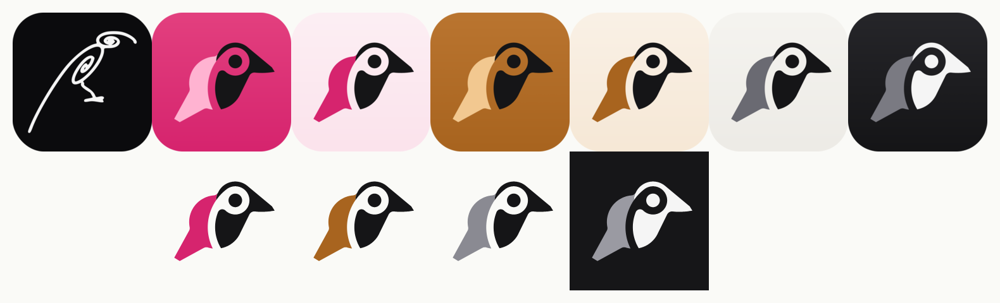

# Raven logo



A solid two-tone raven (body + wing) with an `@` for the eye. Every colourway
is three colours: tile, body, wing.

| File | Use |
| --- | --- |
| `logo-raven.*` | Default app icon (Raven pink accent). Same as `assets/logo.svg`. |
| `logo-classic.*` | Classic (copper) accent preset. |
| `logo-minimal-dark.*` / `logo-minimal-light.*` | Minimal accent preset. |
| `mark-raven.svg`, `mark-classic.svg`, `mark-ink.svg` | Bird only, transparent, for light surfaces. |
| `mark-white.svg` | Bird only, transparent, for dark surfaces. |

The SVGs are generated; edit `scripts/logo/generate.py` and rerun it rather than
editing them by hand:

```sh
python3 scripts/logo/generate.py
```

PNGs (`assets/logo.png` 512px, `assets/apple-touch-icon.png` 180px with square
corners, `tauri-wrapper/src-tauri/icons/icon.png`, and the 1024px PNGs here)
are rendered from the SVGs with any SVG renderer (headless Chromium was used).
